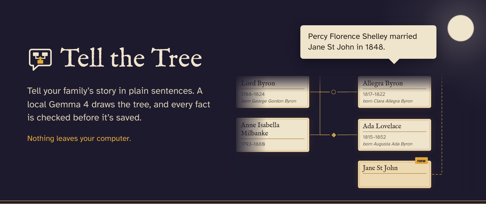

# Tell the Tree

**A family tree you build by telling it, in plain sentences. It runs entirely on your own computer.**

You write sentences like *"Mary's father was William Godwin"* or *"Allegra è figlia di Claire e di Lord Byron"* (English or Italian). A small local model, **Gemma 4 E2B** running through Ollama, reads the sentence. The code checks it against the tree and shows you a **preview** of the change. Nothing is saved until you confirm, and your data never leaves your computer.



Built for DEV's "Ghost in the Machine" challenge, October 2026.

## Why I built it

I used to keep my family tree on a genealogy website. The site shut down, and everything I had entered turned into a 404. I wanted a tree that lives on my own computer, in a file I own, that I can export to a standard format (GEDCOM), and that I can fill in just by telling it what I know.

## How it works: "Gemma copies, the code decides"

The model's job is kept small on purpose:

1. **Gemma copies.** It reads the sentence and copies out the names and the exact kinship word used ("half-brother", "fratellastro", "nipote"...).
2. **The code decides.** An Italian/English dictionary in the code decides what that word means.
3. **Ambiguous words get checked.** In Italian, *nipote* can mean grandchild or nephew/niece. The code looks at the tree, and if that isn't enough, it asks you.
4. **Checks run.** If something doesn't fit, the code asks or refuses.
5. **You see a preview.** New people and links appear dashed and marked "new" in the tree.
6. **You confirm.** Only then is anything saved.

The checks:

- **No cycles:** nobody can become their own ancestor.
- **Impossible dates** are caught.
- **Conflicting parents** are caught.
- **Ambiguous names** become a question: "Which Percy do you mean?"
- **Every fact keeps the sentence it came from**, so you can always see where it came from.

## Features

- Tell the tree in sentences, in English or Italian, with a dashed "new" preview before saving
- Questions when something is ambiguous
- Two themes: a plain register, and Villa Diodati 1816 (with moon and bats)
- Interface in English and Italian
- A photo for each person, stored inside the tree file
- Add a relative by hand, edit or delete people (with the same checks), fix a relationship
- Search
- Horizontal or vertical tree layout
- GEDCOM export and import (tested: exporting the demo and importing it again gives back the same tree)
- PDF register and printable tree

## The demo family

The demo is the Godwin, Shelley and Byron families: Villa Diodati on Lake Geneva, summer 1816, the summer *Frankenstein* was born.

## Getting started

You need [Ollama](https://ollama.com), Python 3, and Node.js with npm.

### 1. Get the model

```bash
ollama pull gemma4:e2b-it-qat
```

Ollama must be running while you use the app.

### 2. Start the backend (from the project folder)

```bash
pip install -r requirements.txt
python -m backend.seed
uvicorn backend.api:app --reload
```

`python -m backend.seed` creates the demo tree.

### 3. Start the frontend (in a second terminal)

```bash
cd frontend
npm install
npm run dev
```

Then open http://localhost:5173.

## Privacy

- Gemma runs on your computer through Ollama. Your sentences, names, dates and photos are not sent anywhere.
- Each tree is a single SQLite file in the `trees/` folder, photos included.
- **`trees/` must never go on GitHub.** It's in `.gitignore`. If you fork this project, keep it that way: that folder is your family.

## Honest results

I measured two things: how often **Gemma alone** read the sentence right, and how often **the whole system** (Gemma plus the code) got it right.

### My 15 test sentences

I wrote these myself while building, so they're "clean": the kind of sentences I knew the app should handle.

| Model | Gemma alone | With the code |
|---|---|---|
| Gemma 4 E2B | 14/15 | 15/15 |
| Gemma 4 E4B | 12/15 (13/15 after one fix) | |

E4B wasn't better on these sentences and was 2.5 times slower, so the app uses E2B.

### 6 secret sentences (holdout)

Before writing the engine, I wrote 6 more sentences and kept them aside. When the code was finished, I froze it with the git tag `holdout-run` and ran them exactly once.

| | Result |
|---|---|
| Gemma alone | **1/6** |
| With the code | **5/6** |

These sentences were in spoken, everyday Italian, and that's where Gemma struggled:

- It copied "Nonna Lucia" (Grandma Lucia) with the title, as if "Nonna" were part of her name.
- It created people out of words that aren't names: "papà" (dad), "figlio di nonno Carlo" (Grandpa Carlo's son).
- It missed relationships that were implied but not said.
- It invented a marriage.

Sentence h06 went the other way: Gemma got it right and **my code got it wrong**. It merged two different Williams into one person, which was exactly the trap I had written into that sentence.

**Read the 5/6 carefully.** It only measures whether the code made the right decision: save, ask, or refuse. In 3 of those 5 cases it would have saved wrong names (like "Nonna Lucia"). What keeps them out of your tree is the preview: you see the dashed "new" people and can say no.

I didn't fix anything before publishing, so these are the real numbers.

### Next steps

- Fix the two-Williams bug
- Remove kinship titles from names ("Nonna", "Zio"...)
- When a "name" isn't really a name (like "papà"), ask instead of creating a person
- Run E4B on the secret sentences

The whole story, mistakes included, is in [DEVLOG.md](DEVLOG.md).

## Tech stack

- **Backend:** Python, FastAPI, SQLite (one file per tree)
- **Frontend:** React, TypeScript, React Flow, dagre
- **Model:** Gemma 4 E2B through Ollama
- **Tests:** 153

## Credits

- Villa Diodati photo by Robertgrassi, public domain, via Wikimedia Commons
- Fonts: Atkinson Hyperlegible (Braille Institute) and IM Fell English (Igino Marini)
- Gemma by Google DeepMind, run locally with Ollama
- React Flow and dagre for drawing the tree

## License

- **Code:** MIT License, see [LICENSE](LICENSE)
- **Fonts:** SIL Open Font License
- **Villa Diodati photo:** public domain
- **The model** is not included in this repository. Ollama downloads it, and it comes with its own license terms.
